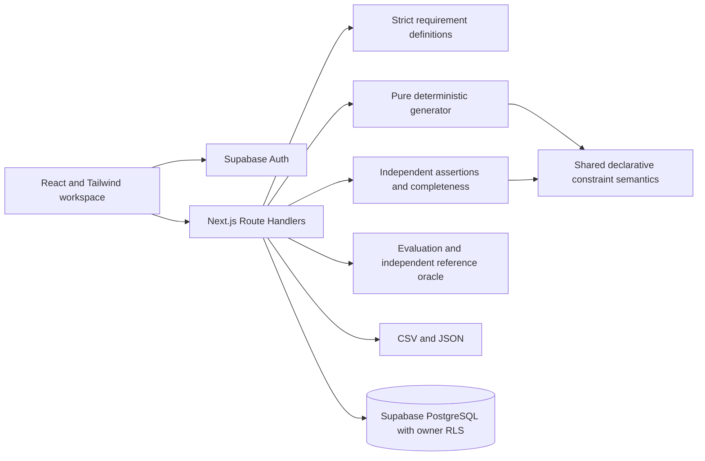
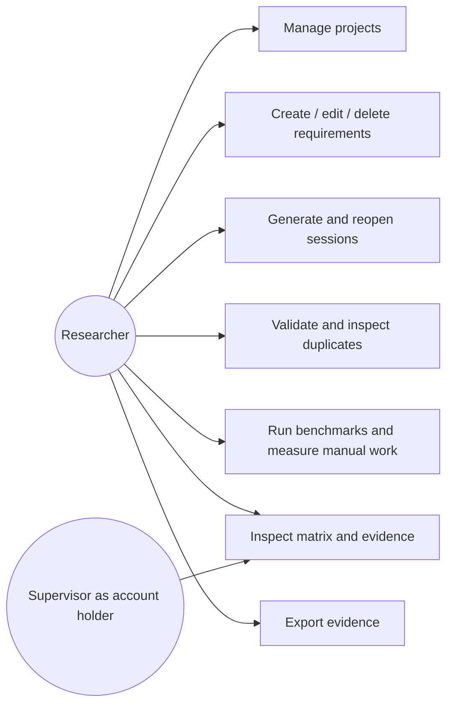
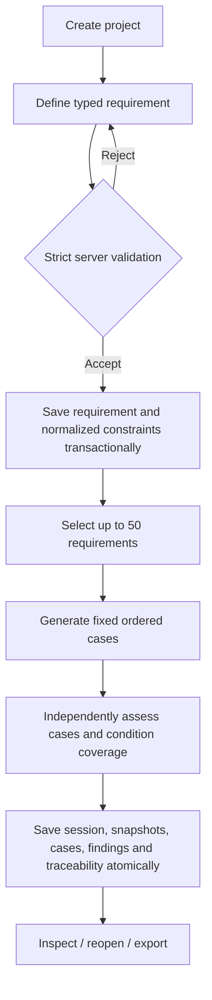

# Architecture and objective mapping

The project keeps its approved title and five research objectives. The application and experiment runner use JavaScript. Benchmark specifications and reference conditions are checked-in static JSON.

| Objective                                         | Implementation                                                                                     | Evidence                                                  |
| ------------------------------------------------- | -------------------------------------------------------------------------------------------------- | --------------------------------------------------------- |
| 1. Analyse testing rules                          | requirements.js, rules.js, documented supported semantics                                          | Rule catalogue; contradictory-definition tests            |
| 2. Generate positive, negative and boundary cases | generator.js, deterministic ordering and fixed representatives                                     | Unit tests and saved generation sessions                  |
| 3. Independently validate                         | validation.js, semantic outcome checks, independently enumerated conditions, duplicate detector    | Mutation tests, findings, matrix                          |
| 4. Evaluate against reference cases               | benchmarks/dataset.json, evaluation.js                                                             | Versioned oracle and raw runs                             |
| 5. Compare automated/manual design                | Coverage, correctness, redundancy and monotonic timings; optional actual manual interval and cases | Raw measurements, protocol notes; no invented manual data |

The application generates test designs for field requirements. Playwright tests this application's principal workflow; the system does not automatically execute generated field cases against arbitrary target websites. One field is modeled per requirement; cross-field, business workflow, state transition and combinatorial testing are outside rule version 1.0.0.

The frontend uses Supabase Auth sessions and sends the access token in an Authorization header. The backend verifies it using getUser and creates a database client with that same user token. No service-role key is required. RLS and composite ownership foreign keys are the final isolation boundary. Bearer authentication avoids ambient-cookie CSRF; production must still guard against XSS and use HTTPS.
