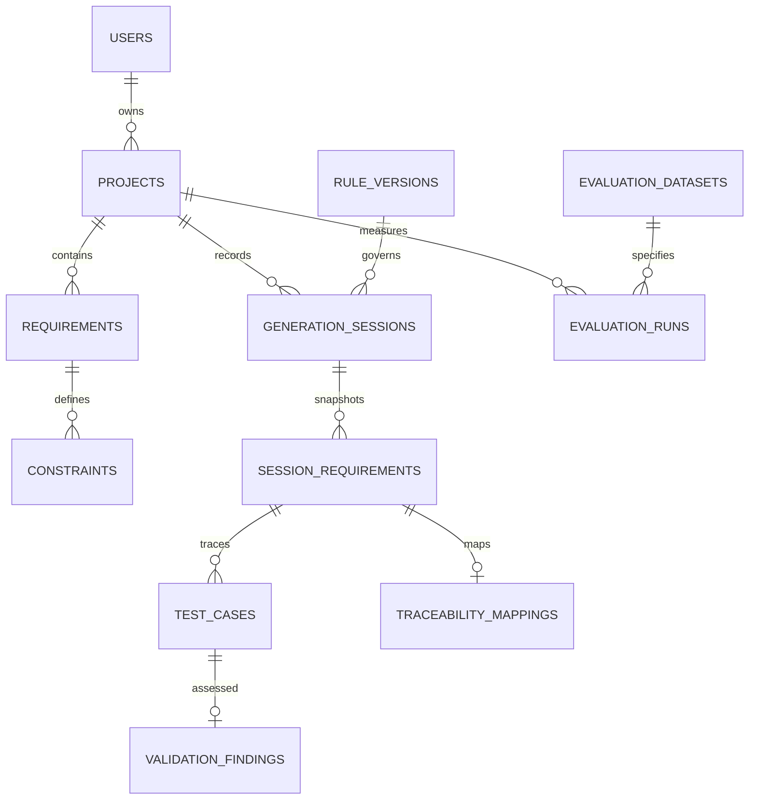

# Database schema

Deploy the SQL migration in supabase/migrations. supabase/schema.sql is the readable source copy. All exposed tables enable RLS, and explicit authenticated grants are included (new Supabase tables may not receive automatic API grants). Rule versions are read-only to application users. Other tables use auth.uid() = owner_id in both USING and WITH CHECK.

| Table                 | Purpose / integrity                                                               |
| --------------------- | --------------------------------------------------------------------------------- |
| projects              | UUID, auth.users owner, title and timestamps                                      |
| requirements          | Live definition JSON, project-owner composite FK, timestamps                      |
| constraints           | Stable requirement:key ID, normalized key/value, unique requirement/key           |
| rule_versions         | Immutable version catalogue seeded by migration                                   |
| generation_sessions   | Project, rule version, core time and saved validation summary                     |
| session_requirements  | Immutable-by-application requirement snapshots; composite session/requirement key |
| test_cases            | Stable text ID, ordinal, snapshot FK and session-owner FK                         |
| validation_findings   | One finding per case/session, case-owner composite FK                             |
| traceability_mappings | One matrix row per requirement/session snapshot                                   |
| evaluation_datasets   | Owner-scoped version and full static dataset payload                              |
| evaluation_runs       | Project, owner-scoped dataset FK, full raw experiment payload                     |

save_requirement replaces the normalized constraints and saves timestamps in one PostgreSQL transaction. save_session atomically saves session snapshots, cases, findings and mappings. A missing FK or RLS violation rolls back the entire function. save_validation replaces findings and mappings and updates the summary atomically. All functions are SECURITY INVOKER with an empty search_path and explicit authenticated EXECUTE grants. No SECURITY DEFINER functions or RLS-bypassing views are used.

Deleting a live requirement deletes its live constraints but retains historical snapshots and cases. Deleting a project cascades all its sessions and evaluation runs. Projects do not have a delete button in the first UI; dedicated test cleanup deletes projects via the authenticated SDK. Snapshot history is stable under normal application operations, not cryptographically tamper-proof: owners can modify their own records through the Data API. Do not treat this as a regulated audit archive.

Index coverage: owner predicates, project list filters, unique session ordinals, normalized requirement constraints and all snapshot lookup prefixes. Session case retrieval pages in batches of 500 to avoid Supabase default response caps.
