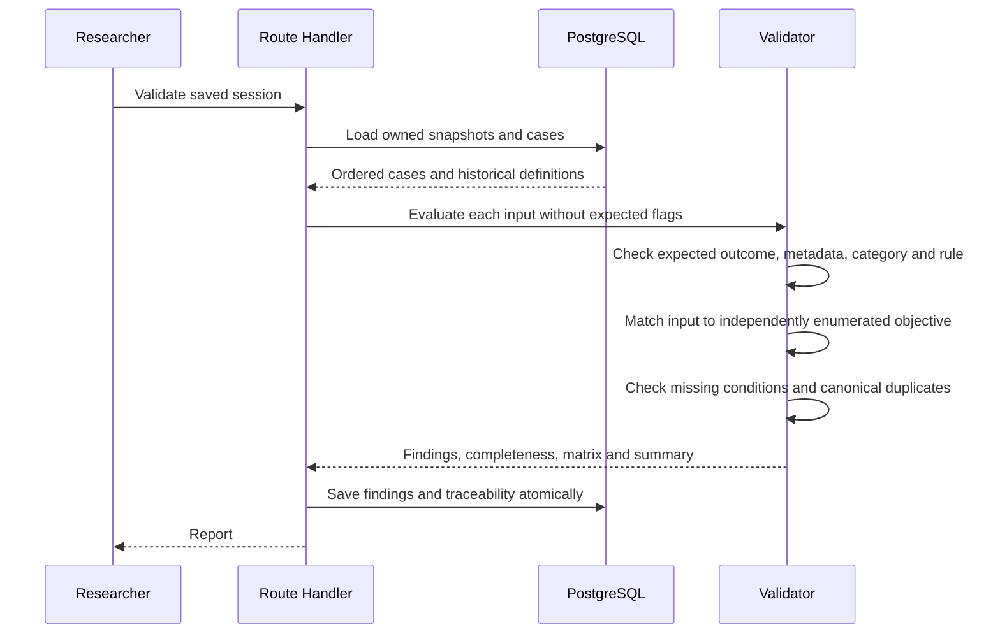

# Independent validation methodology

The validator does not import the generator or trust its expectedValid value. Constraint semantics are shared to avoid contradictory definitions; the validation assertions and enumeration of required conditions are independently implemented in validation.js. Version-controlled reference inputs and expected outcomes add a second, explicitly authored check of semantic assumptions. This is independence of assertions, not two entirely unrelated implementations of the constraint language. Common semantic bugs remain a validity threat and must be reviewed against the oracle and specification.

Each case requires nonempty metadata, typed array containers, a parseable timestamp, unique identity, a real originating snapshot, a known applicable rule/version/technique, and a matching objective and constraint target. Expected validity and expected behaviour text must match independent constraint assessment. Category must agree with validity for EP and boundary rules must use boundary category. Only passed cases contribute to completeness coverage.

Required conditions are independently enumerated: representative valid and empty partitions, wrong type, all enum and boolean partitions, applicable malformed formats and precision/step partitions, and each mathematically representable boundary offset. A missing case is reported even if all remaining cases pass. The matrix includes selected requirements with no cases; the live matrix also identifies current requirements outside the displayed snapshot session.

Passed: all assertions succeed. Failed: at least one independent assertion fails, or a completeness check is missing. Warning: objective-equivalent duplicates exist. Not applicable: a report-level check has no applicable boundary constraints. A duplicate can individually pass correctness while still adding no coverage; the duplication metric penalizes it separately.

Canonical duplicate key: requirement identity, recursively key-sorted JSON input, sorted constraint IDs, expected validity and expected behaviour, objective. IDs, timestamps and descriptive wording do not distinguish logically equivalent cases. A group of N cases contributes N-1 redundant cases. The same input at min+1 and max-1, or valid-representative and enum-membership objectives, is intentionally retained. No fuzzy text similarity or probabilistic duplicate matching is used.

Mutation tests change outcomes, input values, rules, IDs and metadata and remove conditions. These tests verify that the validator can reject plausible-looking generator output instead of merely echoing generation flags.
